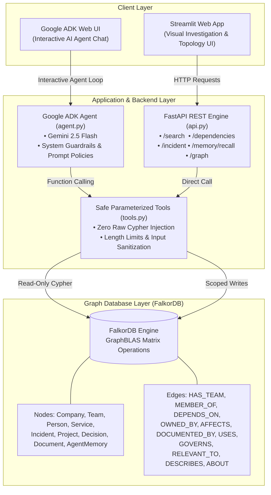
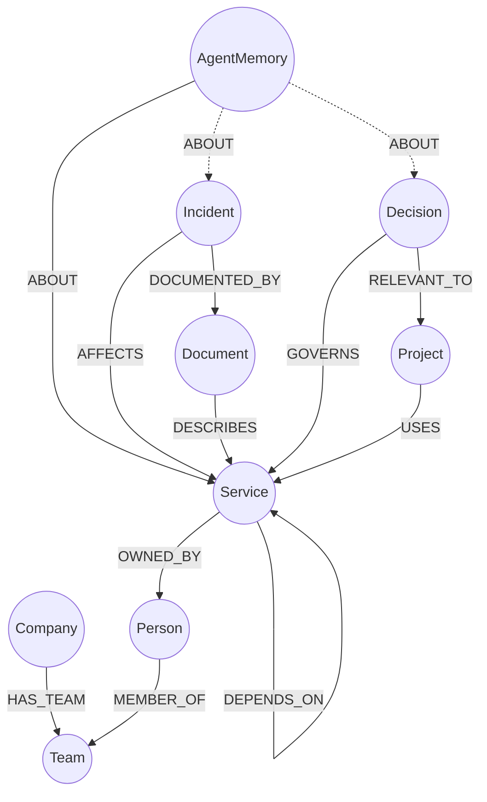

<div align="center">

# 🧠 GraphMind AI
### *The Graph-Native Company Brain & Autonomous Incident Intelligence Agent*

**Built for [Graph Hacks 2026](https://www.wemakedevs.org/) — Organised by WeMakeDevs in collaboration with FalkorDB**

[](https://www.python.org/)
[](https://www.falkordb.com/)
[](https://pypi.org/project/google-adk/)
[](https://aistudio.google.com/)
[](https://fastapi.tiangolo.com/)
[](https://streamlit.io/)
[](https://render.com/)
[](LICENSE)

---

### 📋 Hackathon Submission Details

| Field | Submission Information |
|---|---|
| **Hackathon** | **Graph Hacks** (WeMakeDevs × FalkorDB) |
| **Tracks Entered** | **All Three Tracks:**<br/>1. 🎯 **Agents That Act on Connected Data**<br/>2. 🧠 **Agent Memory and Coordination**<br/>3. 🏛️ **Company Brain** |
| **Primary Database** | **FalkorDB** (Docker locally / FalkorDB Cloud in production) |
| **Live Deployment URL** | `https://graphmind-app.onrender.com` *(Replace with your live Render URL)* |
| **Demo Video URL** | `https://youtu.be/your-demo-video-link` *(Replace with your YouTube/Loom link)* |
| **Source Code Repository** | `https://github.com/<your-username>/graphmind-ai` |
| **Dataset Type** | **100% Synthetic Demo Data** (Compliant with Rule 6) |
| **AI Assistant Disclosure** | Disclosed per Rule 11 (See [AI Disclosure](#-ai-assistant-disclosure-rule-11)) |

---

</div>

https://www.falkordb.com/wp-content/uploads/2024/06/Layer_1-4-1.png

## 📑 Table of Contents
- [Executive Summary](#-executive-summary)
- [How GraphMind Wins All Three Tracks](#-how-graphmind-wins-all-three-tracks)
- [Why FalkorDB is the Essential Core (Rule 3 Proof)](#-why-falkordb-is-the-essential-core-rule-3-proof)
- [System Architecture](#-system-architecture)
- [Knowledge Graph Schema & Data Model](#-knowledge-graph-schema--data-model)
- [Core Cypher Queries & Graph Algorithms](#-core-cypher-queries--graph-algorithms-rule-10)
- [Streamlit UI & Feature Walkthrough](#-streamlit-ui--feature-walkthrough)
- [Google ADK Autonomous Agent](#-google-adk-autonomous-agent)
- [Quickstart: Local Setup (Docker)](#-quickstart-local-setup-docker)
- [Production Deployment: Render & FalkorDB Cloud](#-production-deployment-render--falkordb-cloud)
- [REST API Reference](#-rest-api-reference)
- [Security, Guardrails & Advisory Actions](#-security-guardrails--advisory-actions)
- [Compliance Disclosures](#-compliance-disclosures)

---

## 📌 Executive Summary

During critical outages or complex migrations, engineering teams struggle with **siloed institutional memory**:
- **Cascading Failures:** When a service degrades, engineers don't know which upstream or downstream services depend on it 2 to 4 hops away.
- **Lost Context:** Architecture Decision Records (ADRs) explaining *why* a service was built synchronously are buried in outdated wikis.
- **Repeated Triage Work:** On-call engineers spend hours re-diagnosing issues that were solved days earlier by another team member because past findings are not recorded in a connected way.

**GraphMind AI** is an intelligent, graph-native company intelligence system. Powered by **FalkorDB** as its unified knowledge graph and **Google ADK with Gemini 2.5 Flash** as its autonomous reasoning layer.

---

## 🏆 How GraphMind Wins All Three Tracks

GraphMind explicitly addresses the core requirements of all three hackathon tracks:

### 1. 🎯 Track 1: Agents That Act on Connected Data
- **Multi-Hop Dependency Traversal:** Traverses up to 4 hops of service dependencies (`[:DEPENDS_ON*1..4]`) to detect hidden blast radiuses and upstream failure origins.
- **Incident-to-Action Pipeline:** Connects active incidents (`INC-101`) with impacted services, emergency runbooks, governing architectural decisions, and service owners in a single query.
- **Advisory Action Paradigm:** Evaluates graph evidence and formulates safe, actionable remediation recommendations (e.g., escalating to specific owners, executing targeted runbook procedures).

### 2. 🧠 Track 2: Agent Memory and Coordination
- **Persistent Graph Memory Nodes:** Saves synthesized investigation conclusions directly into the graph as `:AgentMemory` nodes with timestamps and session keys.
- **Polymorphic Entity Association:** Links memories directly to related graph nodes (`(m:AgentMemory)-[:ABOUT]->(entity)`) across services, incidents, and decisions.
- **Cross-Session Coordination:** Allows an agent running in session `user-b` or `shared` to recall findings discovered by `user-a` hours earlier, preventing redundant triage and enabling continuous agent memory.

### 3. 🏛️ Track 3: Company Brain
- **Unified Enterprise Topology:** Maps 9 distinct entity types (Company, Team, Person, Service, Incident, Project, Decision, Document, AgentMemory) into a unified property graph.
- **Holistic Contextual Search:** Searches across people, teams, ADRs, runbooks, and project roadmaps simultaneously, answering queries like *"Who owns the service affected by INC-101 and what decision explains this architecture?"*

---

## ⚡ Why FalkorDB is the Essential Core (Rule 3 Proof)

> **Hackathon Rule 3:** *"The graph has to do real work... if the product still works once FalkorDB is taken out, the graph is decoration rather than the thing the product runs on."*

In GraphMind, **FalkorDB is the fundamental engine, not a decorative visualization**:
1. **Recursive Multi-Hop Traversal:** Tracing dependencies 4 hops deep (`[:DEPENDS_ON*1..4]`) in a relational database requires 4 recursive `JOIN`s or recursive CTEs that collapse under microservice scale.
2. **Polymorphic Contextual Relationships:** Agent findings connect to *any* entity type (`[:ABOUT] -> (Service | Incident | Decision | Project)`). In SQL, this requires complex polymorphic join tables and brittle schema workarounds.
3. **Single Source of Truth:** GraphMind has **no secondary database, no fallback cache, and no mock data layer**. If FalkorDB is offline or stopped, the API `/health` returns `503`, the Streamlit dashboard loses its operational view, and the agent cannot reason over enterprise context.

---

## 🏗️ System Architecture

GraphMind combines an ultra-fast graph engine, an autonomous AI agent, a typed REST API, and an interactive UI into a clean, decoupled architecture:




---

## 🧬 Knowledge Graph Schema & Data Model

GraphMind represents the entire company ecosystem as a labeled property graph:



### Node Labels (Entities)

| Node Label | Key Properties | Purpose in Company Brain |
|---|---|---|
| `:Company` | `id`, `name`, `description` | Root organization boundary (`Acme Commerce`). |
| `:Team` | `id`, `name` | Engineering and operations teams (`Platform Engineering`, `Commerce`). |
| `:Person` | `id`, `name`, `role` | Service owners, on-call leads, and engineers (`Maya Chen`, `Leo Martin`). |
| `:Service` | `id`, `name`, `status` | Microservices & datastores with health state (`healthy`, `degraded`). |
| `:Incident` | `id`, `title`, `description`, `severity`, `status` | Outages and degradation events (`INC-101`, `INC-102`). |
| `:Project` | `id`, `name`, `status` | Business initiatives (`Checkout Modernization`). |
| `:Decision` | `id`, `title`, `summary`, `date` | Architecture Decision Records (ADRs) explaining design choices. |
| `:Document` | `id`, `title`, `content` | Emergency runbooks and operational SOPs (`runbook-001`). |
| `:AgentMemory` | `id`, `session_key`, `finding`, `created_at` | Long-term memory synthesized by the AI agent. |

### Relationship Types (Edges)

| Relationship | Direction | Description |
|---|---|---|
| `[:HAS_TEAM]` | `(Company) -> (Team)` | Department hierarchy. |
| `[:MEMBER_OF]` | `(Person) -> (Team)` | Team personnel membership. |
| `[:DEPENDS_ON]` | `(Service) -> (Service)` | Critical runtime dependency graph (multi-hop). |
| `[:OWNED_BY]` | `(Service) -> (Person)` | Direct human accountability and escalation target. |
| `[:AFFECTS]` | `(Incident) -> (Service)` | Outage blast radius mapping. |
| `[:DOCUMENTED_BY]`| `(Incident) -> (Document)` | Incident triage runbook association. |
| `[:USES]` | `(Project) -> (Service)` | Projects relying on underlying services. |
| `[:GOVERNS]` | `(Decision) -> (Service)` | Architectural rules governing a service. |
| `[:RELEVANT_TO]` | `(Decision) -> (Project)` | Contextual ADR connection to projects. |
| `[:DESCRIBES]` | `(Document) -> (Service)` | Documentation relating to specific services. |
| `[:ABOUT]` | `(AgentMemory) -> (Any)` | Memory graph links tying findings to entities. |

---

## 🔍 Core Cypher Queries & Graph Algorithms (Rule 10)

> **Hackathon Rule 10 Requirement:** *"Every submission must include... The Cypher queries or graph algorithms the product depends on."*

Below are the primary Cypher queries and graph algorithms driving GraphMind:

### 1. Multi-Hop Recursive Dependency & Cascading Blast Radius Traversal
*Algorithm: Variable-length directed path pattern matching with optional multi-branch expansion.*
```cypher
MATCH (s:Service)
WHERE toLower(s.name) CONTAINS toLower($name) OR toLower(s.id) CONTAINS toLower($name)
OPTIONAL MATCH path=(s)-[:DEPENDS_ON*1..4]->(dep:Service)
OPTIONAL MATCH (s)-[:OWNED_BY]->(owner:Person)
OPTIONAL MATCH (inc:Incident)-[:AFFECTS]->(s)
RETURN s.id AS service_id, 
       s.name AS service,
       collect(DISTINCT dep.name) AS dependencies,
       collect(DISTINCT owner.name) AS owners,
       collect(DISTINCT inc.id) AS incidents
LIMIT 10
```
- **Why this matters:** In a single Cypher statement, FalkorDB traverses up to 4 hops of dependencies, identifies who owns the root service, and checks if any known incidents currently affect it.

---

### 2. Incident Evidence & Downstream Impact Correlation
*Algorithm: Bidirectional dependency expansion and multi-entity evidence aggregation.*
```cypher
MATCH (i:Incident)
WHERE toLower(i.id) = toLower($incident_id)
OPTIONAL MATCH (i)-[:AFFECTS]->(s:Service)
OPTIONAL MATCH (i)-[:DOCUMENTED_BY]->(d:Document)
OPTIONAL MATCH (s)-[:OWNED_BY]->(owner:Person)
OPTIONAL MATCH (downstream:Service)-[:DEPENDS_ON]->(s)
RETURN i.id AS incident_id, 
       i.title AS title,
       i.description AS description, 
       i.severity AS severity,
       i.status AS status,
       collect(DISTINCT s.name) AS affected_services,
       collect(DISTINCT d.title) AS documents,
       collect(DISTINCT owner.name) AS owners,
       collect(DISTINCT downstream.name) AS downstream_services
LIMIT 5
```
- **Why this matters:** When an incident hits `Payment API`, this query immediately discovers that `Checkout Service` is downstream and will suffer secondary outages, while simultaneously pulling the relevant runbook and owner data.

---

### 3. Persistent Agent Memory Creation & Topological Edge Linking
*Algorithm: Idempotent graph node creation with dynamic polymorphic edge generation.*
```cypher
// Step 1: Create the immutable AgentMemory node
MERGE (m:AgentMemory {id: $memory_id})
SET m.session_key = $session_key, 
    m.finding     = $finding, 
    m.created_at  = $created_at

// Step 2: Dynamically connect the memory to relevant entities in the graph
MATCH (m:AgentMemory {id: $memory_id})
MATCH (n {id: $entity_id})
MERGE (m)-[:ABOUT]->(n)
```
- **Why this matters:** Synthesized LLM findings aren't dumped into a flat text file. They become first-class graph nodes wired directly into the affected services, incidents, or decisions.

---

### 4. Cross-Session Subgraph Memory Recall
*Algorithm: Session-scoped and shared graph pattern filtering with recency sorting.*
```cypher
MATCH (m:AgentMemory)
WHERE (m.session_key = $session_key OR m.session_key = 'shared')
  AND ($keyword = '' OR toLower(m.finding) CONTAINS toLower($keyword))
OPTIONAL MATCH (m)-[:ABOUT]->(n)
RETURN m.id AS memory_id, 
       m.session_key AS session_key,
       m.finding AS finding, 
       m.created_at AS created_at,
       collect(DISTINCT n.id) AS entity_ids
ORDER BY m.created_at DESC
LIMIT 20
```
- **Why this matters:** Allows agents across disparate sessions to immediately recall verified institutional knowledge by keyword or session context.

---

### 5. Multi-Label Organization Search (Company Brain)
*Algorithm: Broad label union with parameterized predicate filtering.*
```cypher
MATCH (n)
WHERE (n:Incident OR n:Service OR n:Document OR n:Project OR n:Decision OR n:Person OR n:Team)
  AND any(k IN ['id','name','title','description','summary','content','role']
          WHERE n[k] IS NOT NULL AND toLower(toString(n[k])) CONTAINS toLower($keyword))
RETURN labels(n) AS labels, 
       n.id AS id,
       coalesce(n.name, n.title, n.id) AS name,
       coalesce(n.description, n.summary, n.content, n.status, '') AS detail
LIMIT 15
```
- **Why this matters:** Powers the Company Brain search by finding people, teams, services, and runbooks matching a concept in a single round-trip.

---

## 🖥️ Streamlit UI & Feature Walkthrough

The Streamlit interface (`streamlit_app.py`) provides an interactive window into the Company Brain:

```
┌────────────────────────────────────────────────────────────────[...]
│  🧠 GraphMind AI — Company Brain & Incident Investigation Dashboard    │
├──────────────┬──────────────────┬───────────────────┬──────────[...]
│ Investigate  │  Company Brain   │ Persistent Memory │  Graph Explorer  │
└──────────────┴──────────────────┴───────────────────┴──────────[...]
```

1. **Investigate Tab:**
   - **Trace Dependencies:** Trace `Payment API` to see it depends on `Payment Database`, is owned by `Maya Chen`, and connects downstream to `Checkout Service`.
   - **Incident Evidence:** Query `INC-101` to pull the active severity, affected systems, and linked runbook.
2. **Company Brain Tab:**
   - Query terms like `checkout` or `payment` to view connected decisions (*"Keep payment writes synchronous"*), projects (*"Checkout Modernization: at risk"*), and owners.
3. **Persistent Memory Tab:**
   - Recall past agent findings by entering session keys (`demo-user` or `shared`).
4. **Graph Explorer Tab:**
   - Displays real-time counts of nodes and relationships loaded directly from FalkorDB.

---

## 🤖 Google ADK Autonomous Agent

GraphMind integrates with **Google ADK (Agent Development Kit)** and **Gemini 2.5 Flash** (`graphmind/agent.py`) to deliver an autonomous conversational investigation agent.

### Example Prompts to Test with the Agent:
```text
1. "Investigate incident INC-101. What services are degraded, who owns them, and what does the runbook advise?"
2. "Trace dependencies of Payment API. If Payment API fails, what other systems in Acme Commerce are affected?"
3. "Why does Payment API use synchronous writes? Search our company decisions."
4. "Remember this finding under session 'shared': INC-101 pool saturation was caused by synchronous writes during checkout peak."
5. "Recall any memory we have about connection pools."
```

---

## 🚀 Quickstart: Local Setup (Docker)

### Requirements
- Python 3.10+
- Docker & Docker Compose
- Google AI Studio API Key ([Get one here](https://aistudio.google.com/apikey))

### Step-by-Step Installation

```bash
# 1. Clone the repository
git clone https://github.com/<your-username>/graphmind-ai.git
cd graphmind-ai

# 2. Create virtual environment
python -m venv .venv

# On Windows:
.venv\Scripts\Activate.ps1
# On macOS/Linux:
source .venv/bin/activate

# 3. Install dependencies
pip install -r requirements.txt

# 4. Configure environment
cp .env.example .env
# Edit .env and set GOOGLE_API_KEY=your_key_here

# 5. Start FalkorDB
docker compose up -d

# 6. Seed synthetic demo graph
python -m graphmind.seed

# 7. Start FastAPI Backend (Terminal 1)
uvicorn api:app --reload --port 8000

# 8. Start Streamlit UI (Terminal 2)
streamlit run streamlit_app.py

# 9. Start Google ADK Web Agent (Terminal 3, optional)
adk web
```

- Open **Streamlit UI:** `http://localhost:8501`
- Open **FastAPI Swagger Docs:** `http://127.0.0.1:8000/docs`

---

## ☁️ Production Deployment: Render & FalkorDB Cloud

GraphMind is engineered for production deployment on **Render** paired with a free **FalkorDB Cloud** database.

### Step 1: Create Free FalkorDB Cloud Instance
1. Register for free at **[app.falkordb.cloud](https://app.falkordb.cloud)** (no credit card required).
2. Create a free database cluster.
3. Copy your connection URL (format: `falkor://default:<password>@<host>:<port>`).

### Step 2: Deploy to Render via Blueprint (1-Click)
1. Push this repository to your GitHub account:
   ```bash
   git init
   git add .
   git commit -m "Deploy GraphMind to Render"
   git branch -M main
   git remote add origin https://github.com/<your-username>/graphmind-ai.git
   git push -u origin main
   ```
2. Log into the **[Render Dashboard](https://dashboard.render.com)**.
3. Click **New +** > **Blueprint**.
4. Connect your GitHub repository. Render will automatically detect `render.yaml`.
5. Enter your environment variables:
   - `GOOGLE_API_KEY`: Your Gemini API key.
   - `FALKORDB_URL`: Your FalkorDB Cloud connection URL.
6. Click **Apply**. Render will launch the unified web service running both FastAPI and Streamlit on port `$PORT`.

---

## 📡 REST API Reference

The FastAPI service (`api.py`) exposes typed, validated endpoints:

| Method | Endpoint | Description | Request Body Example |
|---|---|---|---|
| `GET` | `/health` | Healthcheck & FalkorDB ping | `None` |
| `POST` | `/seed` | Seeds synthetic demo graph | `None` |
| `POST` | `/search` | Global semantic search | `{"keyword": "payment"}` |
| `POST` | `/dependencies` | Multi-hop dependency trace | `{"service_name": "Payment API"}` |
| `POST` | `/incident` | Incident evidence & runbook | `{"incident_id": "INC-101"}` |
| `POST` | `/memory/recall` | Recalls saved agent findings | `{"session_key": "demo-user", "keyword": ""}` |
| `GET` | `/graph` | Live graph topology snapshot | `None` |

---

## 🛡️ Security, Guardrails & Advisory Actions

- **Zero Raw Cypher Exposure:** The LLM is never given direct Cypher execution privileges. All graph operations use fixed, parameterized functions.
- **Strict Input Constraints:** Parameters have maximum string length limits to prevent denial-of-service and buffer injection.
- **Advisory Recommendations:** GraphMind adheres to safety protocols: it provides verified incident evidence and recommends next actions to human operators rather than performing unverified modifications.

---

## 📜 Compliance Disclosures

### 🤖 AI Assistant Disclosure (Rule 11)
In accordance with **Graph Hacks Rule 11** (*"AI coding assistants are allowed, but their use must be disclosed"*):
- GraphMind AI was conceptualized, architected, and validated by the team.
- An AI coding assistant (Google Antigravity / Gemini) was utilized during the hackathon for code scaffolding, boilerplate generation, and documentation formatting.
- All graph schemas, Cypher traversal queries, ADK tool constraints, and business logic were reviewed, tested, and verified by the team.

### 📊 Synthetic Data Disclosure (Rule 6)
In accordance with **Graph Hacks Rule 6** (*"Your project must use data you are allowed to use: public, synthetic, or your own"*):
- All company names (`Acme Commerce`), microservices, personnel names (`Maya Chen`, `Leo Martin`), incidents, and decisions in this repository are **100% synthetic**.
- No private, proprietary, or restricted corporate information was loaded into the graph.

---

## 👥 Team & License

- **Hackathon:** Graph Hacks 2026 (WeMakeDevs & FalkorDB)
- **License:** Licensed under the [MIT License](LICENSE).

<div align="center">
<sub>Built with 🧠 by the GraphMind Team • Powered by FalkorDB & Google AI</sub>
</div>
